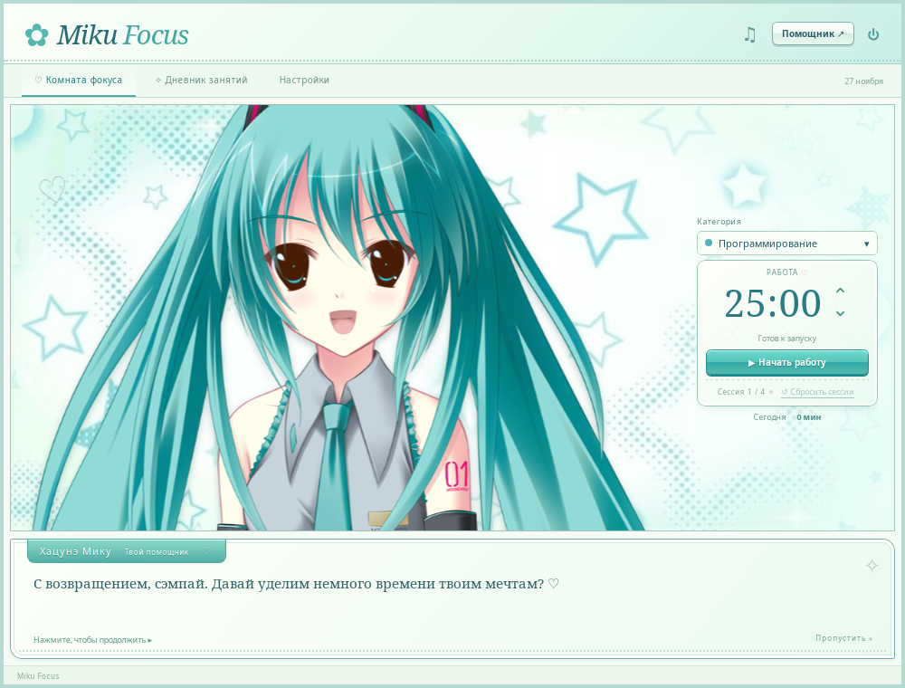
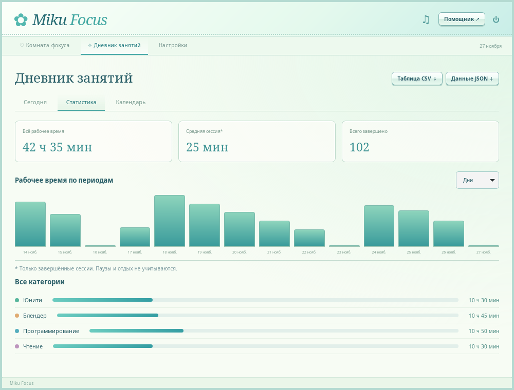
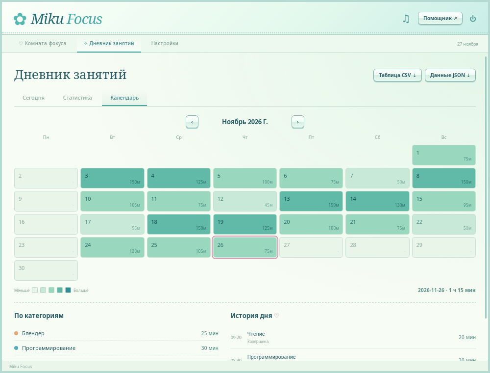
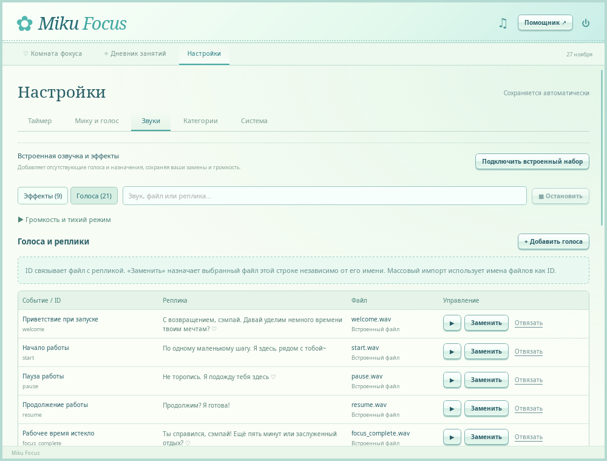

# Miku Focus

Таймер для работы и отдыха с Мику. Выбирайте занятие, занимайтесь своими делами и следите за результатами в дневнике. Всё хранится на вашем компьютере.

[**⬇ Скачать бета-версию**](https://github.com/Demian4ick/MikuTime/releases/tag/v0.1.13-beta.5) · [Все версии](https://github.com/Demian4ick/MikuTime/releases) · [Сообщить об ошибке](https://github.com/Demian4ick/MikuTime/issues)



## Скриншоты

<table>
  <tr><th>Статистика занятий</th><th>Календарь активности</th></tr>
  <tr><td><a href="docs/screenshots/statistics.webp"></a></td><td><a href="docs/screenshots/calendar.webp"></a></td></tr>
  <tr><th>Встроенная озвучка</th><th>Компактный помощник</th></tr>
  <tr><td><a href="docs/screenshots/voices.webp"></a></td><td align="center"><a href="docs/screenshots/companion.webp"></a></td></tr>
</table>

## Установка

На странице беты откройте **Assets** и скачайте файл для своей системы.

- **Windows 10/11 x64:** скачайте и запустите `Miku-Focus-0.1.13-windows-x64-setup.exe`. Установщик пока без цифровой подписи. Если WebView2 отсутствует, для его установки потребуется интернет.
- **Arch Linux x86_64:** скачайте пакет и установите:

  ```sh
  sudo pacman -U ./miku-focus-0.1.13-1-x86_64.pkg.tar.zst
  ```

Перед обновлением полностью закройте приложение. Это бета: если что-то не работает, напишите в [Issues](https://github.com/Demian4ick/MikuTime/issues).

## Возможности

- Рабочие сессии, короткий и длинный отдых, продления без ограничения.
- Категории занятий, дневная цель, статистика и календарь.
- Мику с эмоциями, диалогами и поддержкой собственных голосовых записей.
- Компактный помощник с изменяемым размером.
- Таймер в Waybar на Linux или в области уведомлений Windows.
- Экспорт CSV/JSON и автовыгрузка статистики в Obsidian.

## Как пользоваться

1. Выберите категорию и задайте время стрелками **↑/↓** рядом с таймером.
2. Нажмите **«Начать работу»**. Настройки сохраняются автоматически.
3. После сессии выберите **«Ещё 5 минут»** или **«Завершить и отдохнуть»**. Паузы и отдых не входят в рабочее время.
4. Посмотреть результаты можно в **«Дневнике занятий»**.

**«Сбросить»** завершает текущую сессию с сохранением отработанного времени. **«Сбросить сессии»** обнуляет только счётчик цикла, не текущую работу и не историю.

Крестик основного окна сворачивает приложение в помощника или панель. Для полного выхода используйте кнопку питания или меню значка в трее.

### Категории

В **Настройки → Категории** можно создать своё занятие, выбрать цвет, убрать категорию в архив или удалить. Записанные занятия останутся в дневнике.

### Помощник и диалоги

Клик по помощнику открывает основное окно, перетаскивание перемещает его, правый клик открывает меню. Размер меняется за нижний правый угол.

Первый клик по печатающейся реплике раскрывает текст, следующий продолжает диалог. **Escape** и **«Пропустить»** пропускают реплику. Скорость текста и разговорчивость настраиваются в **«Настройки → Мику и голос»**.

### Звук и оформление

В приложении есть **21 голосовая запись и 9 эффектов**. В **Настройки → Звуки** можно прослушать их, изменить громкость, отключить или заменить своими **WAV/OGG до 20 МиБ**. Тихий режим отключает все звуки.

Если озвучка выключена в вашем профиле, её можно вернуть кнопкой **Подключить встроенный набор**. Свои записи и громкость при этом сохраняются.

В **Настройки → Оформление** можно выбрать светлую или тёмную тему и собрать свою галерею обоев. Поддерживаются до 100 PNG/JPEG, каждый до 20 МиБ и 4096×4096. Выбирайте фон по миниатюре; удаление из галереи не удаляет файлы на диске.

Спрайты Мику можно заменить в **Мику и голос**, а затем вернуть встроенные изображения.

### Obsidian

В **«Настройки → Система»** выберите папку для выгрузки. Linux и Windows сохраняют отдельные JSON со статистикой; таймеры и история между ОС не синхронизируются.

Есть [Dataview-панель](integrations/obsidian/) с графиком по дням, календарём активности и категориями. [Подключение и формат данных](docs/OBSIDIAN.md).

### Waybar и трей

В **«Настройки → Система»** выберите режим сворачивания в панель. Для Waybar добавьте предложенный приложением блок конфигурации вручную. [Инструкция](docs/PANEL.md).

На Hyprland помощника можно перемещать и растягивать. На других Wayland-композиторах возможности окна могут отличаться.

## Данные

Папка данных показана в **«Настройки → Система»**. Стандартные пути:

- Linux: `~/.local/share/dev.mikufocus.desktop/`
- Windows: `%APPDATA%\dev.mikufocus.desktop\`

Настройки и история находятся в `state.json`, предыдущая версия — в `state.backup.json`. После перезапуска рабочая сессия восстанавливается на паузе, отдых продолжается с оставшегося времени. Время закрытого приложения не начисляется.

[Сборка из исходников](docs/RELEASING.md) · [Озвучка и свои записи](docs/VOICE_RECORDINGS.md)

Права на Hatsune Miku и предоставленные изображения/звуки принадлежат соответствующим правообладателям.
